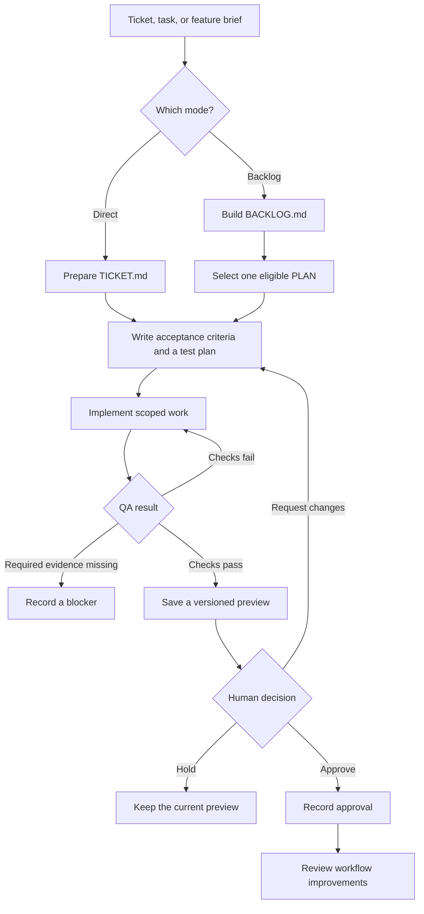

# AI Agency Template

A reusable development workflow for a single ticket, a task description, or a larger feature. The main assistant acts as the Orchestrator. Planner, Backend, Frontend, QA, and Security Audit roles are available when the work needs them. The same workflow can run in one session or delegate to specialists.

## How it works



A `Plan` request stops after the test plan in direct mode or after the backlog in backlog mode. A `Run` request pauses at the preview or at a blocker that prevents completion. Approval closes a direct run. For backlog work, the next eligible PLAN starts when you ask to run it.

## 1. Add the template to your project

1. Extract the archive and copy `agency/` and `.agents/` into the root of the repository or workspace where you want to work. Copy `AGENTS.md` or add its **AI Agency workflow** section to the instructions you already use. Preserve existing project instructions and check for path conflicts before copying. Keep this README as a separate guide if the project already has one.
2. Open that root in your assistant. The table below shows the optional files for native agent integration. Review the files before enabling them or granting workspace trust.
3. Edit [agency/PROJECT.md](agency/PROJECT.md) if you want reusable defaults for sources, code areas, test commands, or preview steps. You can leave the defaults as supplied and specify everything needed for a single run in your prompt.

Copying `agency/` also brings the [Ponytail skill](agency/skills/ponytail/SKILL.md) and its [license](agency/skills/ponytail/LICENSE). The [upstream metadata](agency/skills/ponytail/upstream.json) records the bundled version. Frontend and Backend read the bundled skill from the project before changing source code, including in single-session runs. It works without a separate Ponytail installation. If the bundled file cannot be read, restore it before resuming the blocked implementation.

| Assistant | Setup | How to start |
| --- | --- | --- |
| Codex | Use `AGENTS.md` and shared skills. Copy `.codex/agents/` to enable the named roles. | Use the portable prompt below or select the `agency-orchestrate` skill. |
| Claude Code | Copy `.claude/agents/` and `.claude/skills/` for native roles and skill commands. Use `AGENTS.md` or copy the supplied `CLAUDE.md`, which imports it. If you have a `CLAUDE.md`, add `@AGENTS.md` there if it does not already load the shared instructions. | Use the portable prompt or invoke `/agency-orchestrate` followed by the action and input. |
| Gemini CLI | Use `GEMINI.md`, which imports `AGENTS.md`. If you already use `GEMINI.md`, add `@./AGENTS.md` if needed. Copy `.gemini/agents/` to enable the named roles. Gemini CLI can discover the shared skills in `.agents/skills/`. | Use the portable prompt. In an interactive session, `/skills list` shows the discovered skills. |
| Other repo-aware assistants | Use the shared files from step 1. | Use the portable prompt to load the workflow by path. |

Use the same prompt with or without custom agents. A chat-only assistant needs the relevant files or excerpts pasted or attached. It can draft plans and review supplied evidence. Applying changes and running checks require workspace access or a person to do those steps.

## 2. Choose a starting point

| What you have | What to do |
| --- | --- |
| One ticket or task | Use **direct** mode or let `auto` select it. The workflow records scope, acceptance criteria, the test plan, and QA in one `TICKET.md`. |
| Several tasks, a feature brief, or an existing roadmap | Use **backlog** mode or let `auto` select it for multiple independently reviewable outcomes. The workflow keeps a backlog and prepares one PLAN at a time. |
| Optional context | Supply any combination of a PRD, architecture notes, an existing plan, designs, a contract, paths outside the repo, shared links, or text in the prompt. References must be accessible to the assistant. |

Use a ticket ID or link when the assistant can read the tracker. If access is unavailable, paste the ticket text. A short description is enough to begin. The assistant will inspect the relevant code, tests, and conventions, record reversible assumptions, and ask when an unresolved decision could materially change the result. Omit missing documents or mark them `N/A`. Your prompt overrides the project defaults for that run. To skip configured reference documents for one run, say so in the prompt.

### Start from a single ticket

With the project's AI Agency instructions loaded, send the ticket link in one line.

```text
Read <ticket-url>
```

`Read this <ticket-url>` works the same way. The assistant reads the ticket, chooses or reuses a run ID, prepares the acceptance criteria and test plan, and carries out implementation and QA before stopping at the human preview. If the ticket is inaccessible, paste its description.

For a read-only request, use `Summarize <ticket-url>`. To review the plan before implementation, use `Plan empty-table using <ticket-url>`, then send `Run empty-table` when ready. If your assistant does not load project instructions automatically, ask it to read [AGENTS.md](AGENTS.md) before using the shortcut.

### Start from a feature or an existing plan

```text
Read .agents/skills/agency-orchestrate/SKILL.md and follow the workflow.
Plan account-settings in backlog mode using docs/account-settings.md and the
existing code. Keep the scope in that document. Prepare only.
```

Once the backlog is available, send `Run account-settings.` for the next eligible PLAN, or `Run account-settings PLAN-002.` for a specific one whose dependencies are ready. You can combine planning and execution with `Plan and run account-settings.` when the source is already configured or named in the prompt.

## 3. Review, revise, or resume

The assistant prepares acceptance criteria and a test plan before implementation. After QA, it produces a versioned preview with the result, checks, and review steps. It then waits for your decision.

| What you want | Example |
| --- | --- |
| Accept a ticket result | `Approve empty-table TICKET r01.` |
| Accept a PLAN and run the next one | `Approve account-settings PLAN-001 r01, then run the next PLAN.` |
| Ask for a revision | `Request changes for empty-table TICKET r01. Match the existing table empty-state copy.` |
| Pause at the current preview | `Hold empty-table TICKET r01.` |
| Resume a run in the same or a new session | `Resume empty-table.` |
| Read progress without editing | `Status empty-table.` |

Use the ID and revision shown in your preview. Approval by itself records your decision. A separate run request, or an explicit continuation in the same message, starts the next PLAN. You can switch assistants by opening the same workspace and resuming the same run ID.

## How roles work

Each file in `agency/roles/` gives reusable instructions for a responsibility. The Orchestrator pairs it with the current ticket or PLAN task, which supplies the scope, acceptance criteria, and checks for that assignment. Skills describe repeatable procedures, such as how to write a test plan or verify a result.

| Role | Responsibility |
| --- | --- |
| [Planner](agency/roles/PLANNER.md) | Turns the input into a scoped ticket, backlog, or PLAN breakdown with acceptance criteria. |
| [Backend](agency/roles/BACKEND.md) | Implements the assigned server, data, integration, or CLI change and reports the checks it ran. |
| [Frontend](agency/roles/FRONTEND.md) | Implements the assigned client or UI change and reports checks and preview steps. |
| [QA](agency/roles/QA.md) | Prepares the test plan before implementation and verifies the result against the acceptance criteria afterward. |
| [Security Audit](agency/roles/SECURITY-AUDIT.md) | Reviews security-sensitive changes and reports findings, impact, and remediation. |

The Orchestrator coordinates the work, updates the run records, and waits for your preview decision. It can use a named subagent, brief a generic subagent with the same role file, or carry out the relevant roles in sequence in one session.

### Request a security audit

During planning, the Orchestrator records why an audit applies and what it should cover in the ticket or selected PLAN. QA includes applicable security acceptance criteria in the test plan. The preview records the exact version Security Audit reviewed, its findings, and the status of each fix. Changes that affect the audit evidence trigger a follow-up review of the affected scope before preview. To request a standalone, read-only review, provide the scope in a prompt.

```text
Security audit the current working-tree changes.
```

## Improve the workflow

After you approve a ticket or PLAN, the Orchestrator reviews QA outcomes, handoffs, and your feedback. It records findings in the approved preview. A recurring problem or a confirmed project requirement can lead to a proposed edit to a role, skill, or project default in the current repo.

The preview lists the proposal ID and the exact edit. To approve that edit, send a separate request using the run ID and item ID from the preview.

```text
Apply improvement empty-table TICKET IMP-01
```

For a backlog run, use the PLAN ID in place of `TICKET`. See [agency/WORKFLOW.md](agency/WORKFLOW.md#5-workflow-improvement-review) for the review and apply rules.

## Update the bundled Ponytail skill

The [update workflow](.github/workflows/update-ponytail.yml) belongs in the template repository. It checks the latest stable release every Monday at 02:17 UTC (09:17 WIB). A change to the skill or license opens a pull request with the files and updated upstream metadata.

1. In **Settings → Actions → General → Workflow permissions**, enable **Allow GitHub Actions to create and approve pull requests**. The workflow uses this setting to open pull requests.
2. Once the workflow is on the default branch, open **Actions → Check Ponytail updates → Run workflow** to check on demand.
3. Review the skill and license against the linked upstream release. Merge the pull request when the changes are acceptable. Build the next distribution archive from the merged commit.

## Where to look

| Path | What it contains |
| --- | --- |
| [agency/PROJECT.md](agency/PROJECT.md) | Optional defaults that you can edit by hand. |
| [agency/WORKFLOW.md](agency/WORKFLOW.md) | Intake, execution, QA, and review rules. |
| `agency/roles/` | Shared role instructions for all assistants. |
| `agency/skills/ponytail/` | Bundled implementation skill used by Backend and Frontend. |
| `.agents/skills/` | Shared orchestration, planning, and verification skills. |
| `agency/templates/` | Markdown formats used to write run records. |
| `agency/runs/<run-id>/` | Ticket or backlog, work evidence, and preview history. Created when you start a run. |

Client documentation [Codex subagents](https://learn.chatgpt.com/docs/agent-configuration/subagents) · [Claude Code subagents](https://code.claude.com/docs/en/sub-agents) and [skills](https://code.claude.com/docs/en/skills) · [Gemini CLI subagents](https://geminicli.com/docs/core/subagents/) and [skills](https://geminicli.com/docs/cli/skills/)
