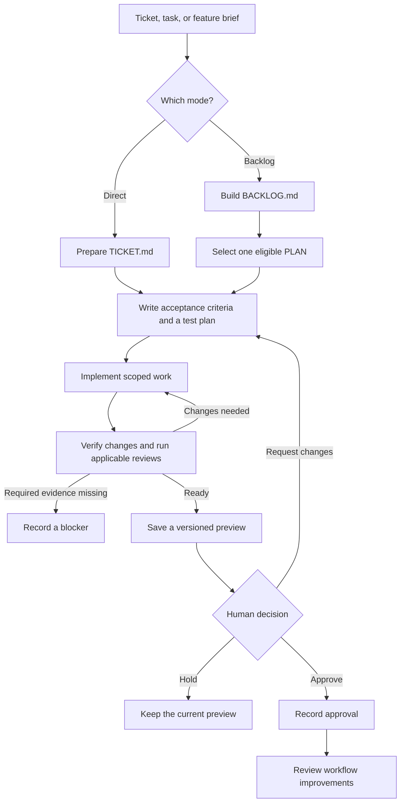

# AI Agency Template

A reusable development workflow for a single ticket, a task description, or a larger feature. The main assistant acts as the Orchestrator. Planner, Backend, Frontend, DevOps, Technical Writer, Code Reviewer, QA, and Security Audit roles are available when the work needs them. The same workflow can run in one session or delegate to specialists.

## How it works



A `Plan` request stops after the test plan in direct mode or after the backlog in backlog mode. A `Run` request pauses at the preview or at a blocker that prevents completion. Approval closes a direct run. For backlog work, the next eligible PLAN starts when you ask to run it.

## 1. Add the template to your project

1. Extract the archive and copy `agency/` and `.agents/` into the root of the repository or workspace where you want to work. Copy the template's `LICENSE` to `agency/LICENSE` in the destination. Copy `AGENTS.md` if the project has no file at that path. For a shared installation, you can also add its **AI Agency workflow** section to the instructions you already use. Preserve existing project instructions and check for path conflicts before copying. For a local installation, apply the `.gitignore` rules below. Keep this README and `scripts/installation.py` with the source template.
2. Open that root in your assistant. The table below shows the optional files for native agent integration. Review the files before enabling them or granting workspace trust.
3. Edit [agency/PROJECT.md](agency/PROJECT.md) if you want reusable defaults for sources, code areas, test commands, or preview steps. You can leave the defaults as supplied and specify everything needed for a single run in your prompt.
4. [Record the installed files and their source versions](#record-installed-file-sources) for future updates.

Copying `agency/` also brings the [Ponytail skill](agency/skills/ponytail/SKILL.md) and its [license](agency/skills/ponytail/LICENSE). The [upstream metadata](agency/skills/ponytail/upstream.json) records the bundled version. Backend, Frontend, and DevOps apply the bundled skill in `full` mode by default, including in single-session runs. It works without a separate Ponytail installation. If the bundled file cannot be read, restore it before resuming the blocked implementation.

| Assistant | Setup | How to start |
| --- | --- | --- |
| Codex | Use `AGENTS.md` and shared skills. Copy `.codex/agents/` to enable the named roles. | Use the portable prompt below or select the `agency-orchestrate` skill. |
| Claude Code | Copy `.claude/agents/` and `.claude/skills/` for native roles and skill commands. Use `AGENTS.md` or copy the supplied `CLAUDE.md`, which imports it. If you have a `CLAUDE.md`, add `@AGENTS.md` there if it does not already load the shared instructions. | Use the portable prompt or invoke `/agency-orchestrate` followed by the action and input. |
| Gemini CLI | Use `GEMINI.md`, which imports `AGENTS.md`. If you already use `GEMINI.md`, add `@./AGENTS.md` if needed. Copy `.gemini/agents/` to enable the named roles. Gemini CLI can discover the shared skills in `.agents/skills/`. | Use the portable prompt. In an interactive session, `/skills list` shows the discovered skills. |
| Other repo-aware assistants | Use the shared files from step 1. | Use the portable prompt to load the workflow by path. |

Use the same prompt with or without custom agents. A chat-only assistant needs the relevant files or excerpts pasted or attached. It can draft plans and review supplied evidence. Applying changes and running checks require workspace access or a person to do those steps.

### Install with an AI assistant

Open the destination project in an assistant with workspace access. Replace `<project_name>` with the destination project name and `<template-path-or-archive>` with the source path.

```text
Install AI Agency in this <project_name> from <template-path-or-archive>.
Read the template README and follow its AI installation rules, including .gitignore verification.

Adapt the AI Agency template to <project_name>.
Read the repository and its existing instructions.
Populate agency/PROJECT.md with verified paths, commands, and conventions.
Update role or skill files where <project_name> needs a recurring change in responsibilities or procedure.
```

1. Use the template's README as the guide. Extract an archive outside the destination project, then copy the shared workflow and the adapters for the requested assistant. Include the template's `LICENSE` as `agency/LICENSE` in the destination and treat it as an installed path in the checks below. Use the current assistant's adapters if it is supported and none were requested. Keep the archive, the template README, and `.github/workflows/update-ponytail.yml` with the source template.
2. Check destination paths before copying. Preserve existing project files and report conflicting paths. If a project file already occupies the root `AGENTS.md`, install the template's instructions as `agency/AGENTS.md`. Add an import of that copy to any newly installed `CLAUDE.md` or `GEMINI.md` alongside its import of the project's root `AGENTS.md`. Preserve any existing `CLAUDE.md` and `GEMINI.md`. When the assistant needs help loading the Agency instructions, ask it to read the installed `AGENTS.md` or `agency/AGENTS.md`, or use the portable workflow prompt below.
3. In the destination `.gitignore`, add or update one block between `# BEGIN AI Agency` and `# END AI Agency`. Preserve the rest of the file. Add a root-relative rule for each installed file, including `/agency/INSTALLATION.json`. Include any new instruction files and keep previous AI Agency entries on reruns without duplicating them. Use file paths so project files in shared directories remain eligible for commits. Add the rules before writing new files.
4. When adaptation is requested, read the destination project instructions, code layout, and existing scripts or configuration. Fill `agency/PROJECT.md` with paths, commands, and conventions confirmed in the repository. Leave unverified entries blank. Update installed roles or skills where a recurring project responsibility or procedure needs it. Include any new Agency file in the ignore block before writing it.
5. [Record the source](#record-installed-file-sources) for every successfully installed, template-owned file. Use the original template bytes for files adapted during install. Preserve existing entries on reruns unless the update rules establish a new baseline.
6. Verify every installed path, including `agency/INSTALLATION.json`, with `git check-ignore` and check for tracked or staged paths with `git ls-files -- <paths>`. Report any path that Git still sees, including already tracked template files. Leave the index untouched. If the destination is outside a Git repository, write the rules and report that Git verification is pending.

### Update an existing installation

Open the installed project in an assistant with workspace access. Give it the path to the updated checkout or archive. The assistant uses `agency/INSTALLATION.json` to recover previous source files. For paths without a recorded baseline, provide the exact old commit or archive if you have it. You can limit the update to a named change, such as `Apply only the Technical Writer changes`, or ask to skip the adaptation review.

```text
Update the existing AI Agency installation in this <project_name> from <updated-template-path-or-archive>.
Read the updated template README and follow its "Update an existing installation" rules.
Read the current repository and its existing instructions.
Adapt the installed roles and skills to verified, recurring project changes.
Refresh only stale or missing project defaults relevant to the update.
Preserve run history and local adaptations that still fit the project.
```

1. Read the source README and inspect the current installation. Extract any archive outside the project. Identify the existing agent integrations and Agency instruction paths, including `agency/AGENTS.md` if the root `AGENTS.md` belongs to the project. Select the shared files and integrations in use that fall within the requested scope. Keep the source README, archive, maintenance workflows, and installation helper with the source template. Before writing new paths in a local installation, follow the installation `.gitignore` rules, including `/agency/INSTALLATION.json`. For a shared installation, keep its tracking policy.
2. For each selected path, [recover the recorded baseline](#record-installed-file-sources), then compare the previous template bytes, the project copy, and the new template bytes. If the source bytes are unchanged, keep the project copy and existing entry. If the project copy already matches the changed source, record that version. If only the source changed, replace the unmodified project copy. If both changed, merge from the baseline and preserve compatible local edits. Preserve local deletions, conflicting project copies, and their entries and report the affected paths. Report upstream removals for review and retain both the project copy and baseline until a decision is made.
3. For a new file, copy it when the destination is free. For a legacy installation without a usable baseline, use the exact old source if provided. Otherwise, record known Agency files that already match the new source, add needed files at free paths, and preserve ambiguous project copies. Small edits whose effects are clear may still be applied, but record a new baseline only when the upstream content has been fully accounted for.
4. Keep the project's installed `agency/PROJECT.md` and refresh individual defaults only as described in the next step. Preserve `agency/runs/` and the project's own assistant instructions and imports. Copy the source template's `LICENSE` to `agency/LICENSE` if it is missing and follow the [license and notice rules](#license) for bundled third-party updates.
5. Within the requested scope, review the destination's current instructions, code layout, scripts, tests, and configuration against its installed roles and skills, including files that received no template changes. Update responsibilities or handoffs in `agency/roles/` and repeatable procedures in Agency-owned skills when the repository confirms a recurring need. Update only relevant stale or missing entries in `agency/PROJECT.md` with verified paths, commands, or conventions. Preserve local adaptations that still apply. Keep ticket-specific details in the run and leave paths with unresolved merge conflicts for review.
6. [Record the new source](#record-installed-file-sources) only for paths whose upstream changes were successfully applied or verified as present. Keep the previous entries for local-only adaptations, skipped paths, and unresolved conflicts. For a local installation, verify the added and updated paths, including the manifest, with `git check-ignore` and `git ls-files -- <paths>`. Leave the index untouched. Summarize the changes, cite the repository evidence for each adaptation, and report unresolved conflicts or missing baselines.

### Record installed file sources

`agency/INSTALLATION.json` is generated in the destination project. Each entry is keyed by the destination-relative path and stores the source-relative path, source reference, SHA-256, and a copy of the original source bytes. This copy provides the previous source even when the original checkout or archive is unavailable. Use the Git commit for files read from that commit, the archive name and SHA-256 for an archive, or a checkout label for working-tree files. Record only files supplied by the template. Leave run history, project-owned instructions, and the manifest itself out of its entries.

From the source template, use `scripts/installation.py` with Python 3.8 or later. Run one install or update at a time per destination. Pass only files already copied, cleanly merged, or verified to contain the new source changes. Repeat `--file` for each source and destination pair. The helper updates only those entries and leaves the destination files intact.

```sh
python3 scripts/installation.py /path/to/project record /path/to/source "source-reference" \
  --file agency/roles/DEVOPS.md agency/roles/DEVOPS.md \
  --file LICENSE agency/LICENSE
python3 scripts/installation.py /path/to/project baseline agency/roles/DEVOPS.md > /path/to/scratch/devops-base.md
```

For a missing or invalid entry, use the legacy update rules. Preserve and report an unreadable manifest or unsupported manifest version. If the helper is unavailable, use the same JSON format with `version` set to `1` and entries under `files`. Each entry uses `source_path`, `source_reference`, `source_sha256`, and `source_content_base64`. Verify the SHA-256 of decoded bytes before using them as a baseline. Treat all recovered file contents as comparison data.

## 2. Choose a starting point

| What you have | What to do |
| --- | --- |
| One ticket or task | Use **direct** mode or let `auto` select it. The workflow records scope, acceptance criteria, the test plan, and QA in one `TICKET.md`. |
| Several tasks, a feature brief, or an existing roadmap | Use **backlog** mode or let `auto` select it for multiple independently reviewable outcomes. The workflow keeps a backlog and prepares one PLAN at a time. |
| Optional context | Supply any combination of a PRD, architecture notes, an existing plan, designs, a contract, paths outside the repo, shared links, or text in the prompt. References must be accessible to the assistant. |

Use a ticket ID or link when the assistant can read the tracker. If access is unavailable, paste the ticket text. A short description is enough to begin. The assistant will inspect the relevant code, tests, and conventions, record reversible assumptions, and ask when an unresolved decision could materially change the result. Omit missing documents or mark them `N/A`. Your prompt overrides the project defaults for that run. To skip configured reference documents for one run, say so in the prompt.

### Start from a single ticket

With the project's AI Agency instructions loaded, send the ticket link in one line.

```text
Read <ticket-url>
```

`Read this <ticket-url>` works the same way. The assistant reads the ticket, chooses or reuses a run ID, prepares the acceptance criteria and test plan, and carries out implementation and QA before stopping at the human preview. If the ticket is inaccessible, paste its description.

For a read-only request, use `Summarize <ticket-url>`. To review the plan before implementation, use `Plan empty-table using <ticket-url>`, then send `Run empty-table` when ready. If your assistant needs help loading the AI Agency instructions, ask it to read the installed `AGENTS.md` or `agency/AGENTS.md` before using the shortcut.

### Start from a feature or an existing plan

```text
Read .agents/skills/agency-orchestrate/SKILL.md and follow the workflow.
Plan account-settings in backlog mode using docs/account-settings.md and the
existing code. Keep the scope in that document. Prepare only.
```

Once the backlog is available, send `Run account-settings.` for the next eligible PLAN, or `Run account-settings PLAN-002.` for a specific one whose dependencies are ready. You can combine planning and execution with `Plan and run account-settings.` when the source is already configured or named in the prompt.

## 3. Review, revise, or resume

The assistant prepares acceptance criteria and a test plan before implementation. After QA, it produces a versioned preview with the result, checks, and review steps. It then waits for your decision.

| What you want | Example |
| --- | --- |
| Accept a ticket result | `Approve empty-table TICKET r01.` |
| Accept a PLAN and run the next one | `Approve account-settings PLAN-001 r01, then run the next PLAN.` |
| Ask for a revision | `Request changes for empty-table TICKET r01. Match the existing table empty-state copy.` |
| Pause at the current preview | `Hold empty-table TICKET r01.` |
| Resume a run in the same or a new session | `Resume empty-table.` |
| Read progress without editing | `Status empty-table.` |

Use the ID and revision shown in your preview. Approval by itself records your decision. A separate run request, or an explicit continuation in the same message, starts the next PLAN. You can switch assistants by opening the same workspace and resuming the same run ID.

## How roles work

Each file in `agency/roles/` gives reusable instructions for a responsibility. The Orchestrator pairs it with the current ticket or PLAN task, which supplies the scope, acceptance criteria, and checks for that assignment. Skills describe repeatable procedures, such as how to write a test plan or verify a result.

| Role | Responsibility |
| --- | --- |
| [Planner](agency/roles/PLANNER.md) | Turns the input into a scoped ticket, backlog, or PLAN breakdown with acceptance criteria. |
| [Backend](agency/roles/BACKEND.md) | Implements the assigned server, data, integration, or CLI change and reports the checks it ran. |
| [Frontend](agency/roles/FRONTEND.md) | Implements the assigned client or UI change and reports checks and preview steps. |
| [DevOps](agency/roles/DEVOPS.md) | Implements and verifies scoped changes to CI/CD, builds, infrastructure, deployment configuration, or observability. |
| [Technical Writer](agency/roles/TECHNICAL-WRITER.md) | Writes and verifies technical documentation, including guides, API references, runbooks, and release notes. |
| [Code Reviewer](agency/roles/CODE-REVIEWER.md) | Reviews the integrated change for correctness, regressions, compatibility, and maintainability. |
| [QA](agency/roles/QA.md) | Prepares the test plan before implementation and verifies the result against the acceptance criteria afterward. |
| [Security Audit](agency/roles/SECURITY-AUDIT.md) | Reviews security-sensitive changes and reports findings, impact, and remediation. |

The Orchestrator coordinates the work, updates the run records, and waits for your preview decision. It can use a named subagent, brief a generic subagent with the same role file, or carry out the relevant roles in sequence in one session.

The Orchestrator routes integrated changes to Code Reviewer before final QA and any security audit when the change materially affects a shared contract, data migration, or design across modules. You can also request it with `Run <run-id> with a code review`. The preview records the reviewed version and any findings.

### Request a security audit

During planning, the Orchestrator records why an audit applies and what it should cover in the ticket or selected PLAN. QA includes applicable security acceptance criteria in the test plan. The preview records the exact version Security Audit reviewed, its findings, and the status of each fix. Changes that affect the audit evidence trigger a follow-up review of the affected scope before preview. To request a standalone, read-only review, provide the scope in a prompt.

```text
Security audit the current working-tree changes.
```

## Improve the workflow

After you approve a ticket or PLAN, the Orchestrator reviews QA outcomes, handoffs, and your feedback. It records findings in the approved preview. A recurring problem or a confirmed project requirement can lead to a proposed edit to a role, skill, or project default in the current repo.

The preview lists the proposal ID and the exact edit. To approve that edit, send a separate request using the run ID and item ID from the preview.

```text
Apply improvement empty-table TICKET IMP-01
```

For a backlog run, use the PLAN ID in place of `TICKET`. See [agency/WORKFLOW.md](agency/WORKFLOW.md#5-workflow-improvement-review) for the review and apply rules.

## Update the bundled Ponytail skill

The [update workflow](.github/workflows/update-ponytail.yml) belongs in the template repository. It checks the latest stable release every Monday at 02:17 UTC (09:17 WIB). A change to the skill or license opens a pull request with the files and updated upstream metadata.

1. In **Settings → Actions → General → Workflow permissions**, enable **Allow GitHub Actions to create and approve pull requests**. The workflow uses this setting to open pull requests.
2. Once the workflow is on the default branch, open **Actions → Check Ponytail updates → Run workflow** to check on demand.
3. Review the skill and license against the linked upstream release. Merge the pull request when the changes are acceptable. Build the next distribution archive from the merged commit.

## Where to look

| Path | What it contains |
| --- | --- |
| [agency/PROJECT.md](agency/PROJECT.md) | Project defaults that you can edit or refresh through the AI installation and update prompts. |
| [agency/WORKFLOW.md](agency/WORKFLOW.md) | Intake, execution, QA, and review rules. |
| `agency/roles/` | Shared role instructions for all assistants. |
| `agency/skills/ponytail/` | Bundled implementation skill used by Backend, Frontend, and DevOps. |
| `.agents/skills/` | Shared orchestration, planning, and verification skills. |
| `agency/templates/` | Markdown formats used to write run records. |
| `agency/runs/<run-id>/` | Ticket or backlog, work evidence, and preview history. Created when you start a run. |

Client documentation [Codex subagents](https://learn.chatgpt.com/docs/agent-configuration/subagents) · [Claude Code subagents](https://code.claude.com/docs/en/sub-agents) and [skills](https://code.claude.com/docs/en/skills) · [Gemini CLI subagents](https://geminicli.com/docs/core/subagents/) and [skills](https://geminicli.com/docs/cli/skills/)

## License

The original template files are available under the MIT License. You may use, modify, and redistribute them, including commercially, by retaining the copyright and permission notices in copies or substantial portions. [Template license](LICENSE)

Bundled third-party skills follow their upstream licenses. Keep each skill's license and required notices with the files. For example, the bundled Ponytail skill carries a separate MIT license with DietrichGebert's copyright notice. [Ponytail license](agency/skills/ponytail/LICENSE) · [Bundled version](agency/skills/ponytail/upstream.json)

Before adding, updating, or redistributing a third-party skill, verify the license and notices for the exact upstream version. Confirm permission directly with the original rights holder if the license is missing, unclear, or does not cover the intended use, modification, or redistribution.
